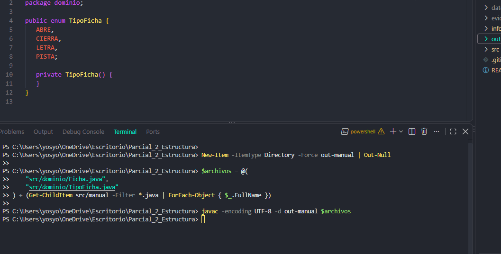
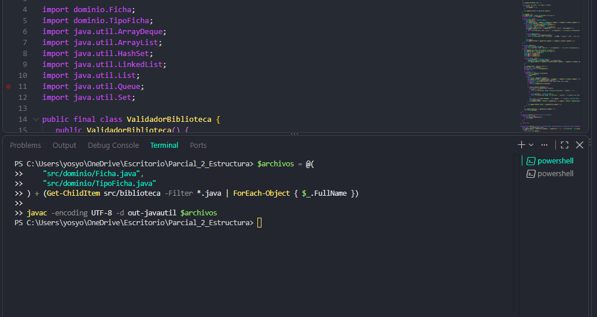
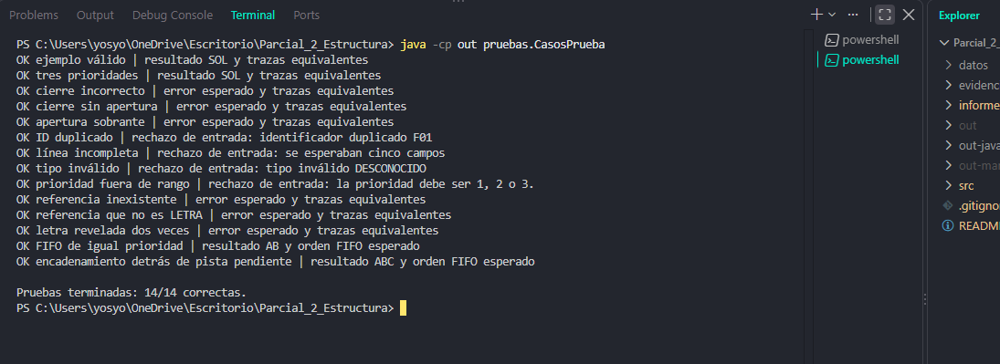
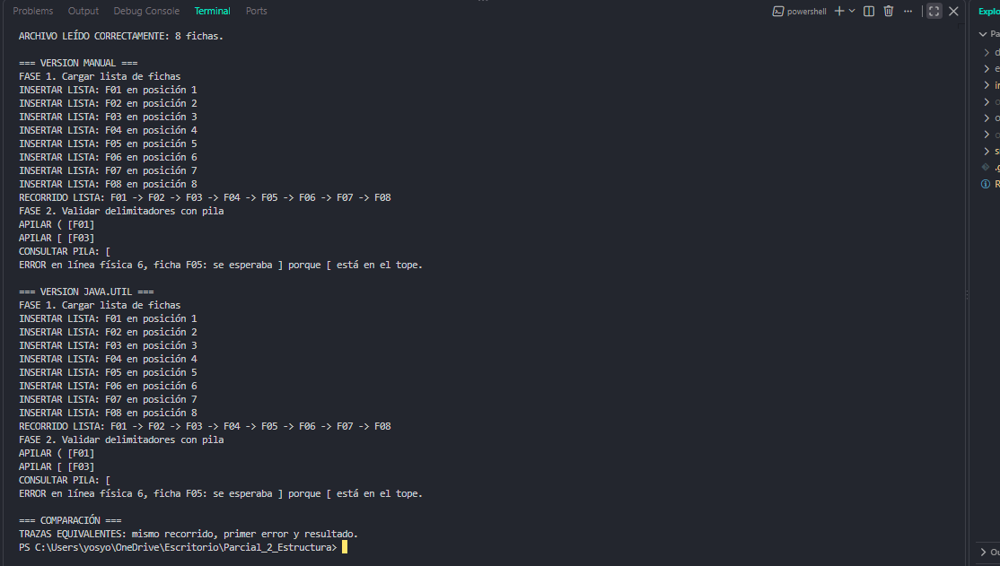

# Informe técnico final: La bóveda de los patrones

**Asignatura:** Estructuras de Datos  
**Modalidad:** Trabajo individual  
**Lenguaje:** Java  
**Estudiante:** [Escribe tu nombre completo]  
**Docente:** [Escribe el nombre del docente]  
**Fecha:** 12 de noviembre de 2026  
**Repositorio:** [Alejo04503/Parcial_2_Estructura](https://github.com/Alejo04503/Parcial_2_Estructura)

---

## Resumen

El proyecto **La bóveda de los patrones** consiste en leer un archivo de fichas, validar el anidamiento de delimitadores y descifrar un mensaje mediante pistas organizadas por prioridad. Se desarrollaron dos soluciones con el mismo comportamiento observable: una implementación manual de las estructuras de datos y otra basada en colecciones de la biblioteca estándar `java.util`.

La versión manual utiliza una lista enlazada, una pila y tres colas FIFO. La versión con biblioteca utiliza una lista de Java, una pila basada en `Deque` y tres colas `Queue`. Ambas procesan la misma entrada, registran sus operaciones y permiten comparar el recorrido, el primer error y el mensaje obtenido.

En el ejemplo principal se leen nueve fichas. La pista F09 ejecuta `ENCADENAR:F04:F06`: revela la letra O y genera una nueva pista para revelar L. Junto con la S obtenida previamente, el resultado es **SOL**. La verificación local realizada el 12 de noviembre de 2026 registró compilación completa sin errores, trazas equivalentes y **14 de 14 pruebas automatizadas correctas**.

## 1. Objetivo y reglas del problema

El objetivo es aplicar estructuras de datos para resolver un proceso de lectura, validación y descifrado. El programa recibe un archivo de texto UTF-8 cuyo encabezado es:

```text
id|tipo|valor|prioridad|instruccion
```

Cada registro contiene cinco campos separados por `|`. El identificador debe ser único y no estar vacío. Los tipos permitidos son `ABRE`, `CIERRA`, `LETRA` y `PISTA`. La prioridad debe ser un entero entre 1 y 3. Las instrucciones de una pista pueden ser `REVELAR:id` o `ENCADENAR:id1:id2`; los demás tipos utilizan `-`.

El programa conserva tanto la posición de la ficha dentro de la secuencia como el número de línea física del archivo. Así, los errores pueden señalar el registro y la línea exactos. Si una fase encuentra un error, el procesamiento se detiene y no se ejecutan las fases posteriores.

## 2. Organización del programa

El código se divide en paquetes con responsabilidades concretas:

| Paquete | Responsabilidad |
|---|---|
| `dominio` | Define `Ficha` y `TipoFicha`, que representan los datos de entrada. |
| `app` | Lee el archivo, coordina las implementaciones y compara las trazas. |
| `manual` | Contiene nodos, lista enlazada, pila, colas y validador propios. |
| `biblioteca` | Implementa el mismo procesamiento con colecciones `java.util`. |
| `pruebas` | Ejecuta los 14 escenarios automatizados. |

Esta separación evita mezclar la lectura y validación del archivo con los detalles internos de cada estructura. El lector construye las fichas y los validadores ejecutan las mismas fases sobre esa entrada.

## 3. Estructuras de datos implementadas manualmente

### 3.1 Lista enlazada

La clase `ListaFichas` enlaza nodos que contienen fichas. Mantiene referencias a la cabeza y a la cola, además de un contador. La inserción conserva el orden de lectura: el primer nodo se convierte en cabeza y cola; los siguientes se enlazan al final.

El recorrido muestra las fichas en el orden original. Para resolver una referencia por ID, se realiza una búsqueda secuencial desde la cabeza hasta encontrar la ficha o alcanzar el final. También se lleva un registro de las fichas reveladas para impedir que una misma letra se agregue dos veces al mensaje.

### 3.2 Pila de símbolos

La clase `PilaSimbolos` almacena las aperturas mediante nodos y una referencia al tope. Sus operaciones principales son apilar, consultar el tope y retirar el elemento superior. Su comportamiento es **LIFO**: el último símbolo que entra es el primero que debe salir.

Cuando aparece una apertura, se apila. Cuando aparece un cierre, se compara con la apertura del tope. Solo se retira si forman una pareja correcta. Por ejemplo, después de apilar `(` y luego `[`, el cierre válido inmediato es `]`. Si el cierre no coincide, no existe una apertura o quedan aperturas al terminar, se informa el primer error.

### 3.3 Tres colas FIFO por prioridad

La clase `ColaPistas` administra tres colas enlazadas independientes, una por prioridad. Cada cola conserva referencias al frente y al final. Al encolar, el nuevo nodo se agrega al final; al desencolar, se busca desde P1 hasta P3 y se retira el primer elemento disponible.

La regla es doble: se atiende P1 antes que P2 y P2 antes que P3; dentro de una misma prioridad se conserva **FIFO**, es decir, primero se atiende la pista que llegó primero. Si una pista genera otra, esta se agrega al final de la cola de la misma prioridad, detrás de las que ya estaban esperando.

## 4. Implementación con java.util y equivalencia

La segunda solución reproduce las mismas fases utilizando colecciones estándar: una lista de Java para las fichas, `Deque` para la pila y tres colas `Queue` para las prioridades. Se mantienen tres colas independientes para que la regla P1 → P2 → P3 sea explícita y el orden FIFO se conserve dentro de cada una.

Las implementaciones no comparten la misma estructura interna. La equivalencia significa que, ante la misma entrada, producen el mismo recorrido observable, el mismo primer error, el mismo orden de eventos y el mismo resultado. La clase principal compara las trazas de ambas versiones después de retirar sus encabezados particulares.

## 5. Lectura, validación y flujo de ejecución

La clase `LectorFichas` lee el archivo como UTF-8 y valida el encabezado, la cantidad de campos, los identificadores, los tipos, los valores, las prioridades y las instrucciones. Conserva los campos vacíos al separar cada línea para detectar registros incompletos. También rechaza identificadores duplicados y referencias con formato inválido.

Después de leer correctamente, el programa sigue este orden:

1. **Construcción y recorrido de la lista:** conserva y muestra las fichas en el orden del archivo.
2. **Validación con la pila:** comprueba que los delimitadores `()`, `[]` y `{}` estén correctamente anidados.
3. **Distribución de pistas:** solo si la pila queda vacía, organiza las pistas en P1, P2 y P3.
4. **Resolución:** atiende las pistas, busca sus referencias y construye el mensaje.
5. **Comparación:** ejecuta ambas versiones y verifica que sus trazas coincidan.

`REVELAR:id` busca una ficha de tipo `LETRA` que todavía no se haya revelado y agrega su valor al mensaje. `ENCADENAR:id1:id2` revela primero `id1` y genera una nueva pista `REVELAR:id2`, que se encola al final de la misma prioridad. Una referencia inexistente, una referencia a otro tipo o una letra repetida produce un error.

## 6. Ejecución del ejemplo principal

El archivo `datos/ejemplo_valido.txt` contiene las fichas F01 a F09. Las fichas de apertura y cierre permiten comprobar el funcionamiento de la pila. Cuando la pila queda vacía, se procesan las pistas:

| Orden | Operación | Mensaje |
|---:|---|---|
| 1 | F08, prioridad 1, ejecuta `REVELAR:F02` y agrega S. | `S` |
| 2 | F09, prioridad 2, ejecuta `ENCADENAR:F04:F06` y agrega O. | `SO` |
| 3 | F09 genera y encola `REVELAR:F06` en P2. | `SO` |
| 4 | Se atiende la pista generada y se agrega L. | `SOL` |

El resultado final es **SOL**. La ejecución de ambas versiones termina con el mismo mensaje y la comparación informa:

```text
TRAZAS EQUIVALENTES: mismo recorrido, primer error y resultado.
```

## 7. Pruebas realizadas

La clase `pruebas.CasosPrueba` ejecuta 14 escenarios. Los archivos persistentes cubren el ejemplo válido, las tres prioridades y el cierre incorrecto; los demás escenarios generan entradas temporales para probar errores y comportamientos específicos.

| N.º | Caso | Resultado comprobado |
|---:|---|---|
| 1 | Ejemplo válido | Mensaje SOL y trazas equivalentes. |
| 2 | Tres prioridades | Atención P1 → P2 → P3. |
| 3 | Cierre incorrecto | Se detecta el cruce de delimitadores. |
| 4 | Cierre sin apertura | Se rechaza el cierre sin pareja. |
| 5 | Apertura sobrante | Se detecta la pila no vacía al final. |
| 6 | ID duplicado | Se rechaza el identificador repetido. |
| 7 | Línea incompleta | Se rechaza un registro con menos de cinco campos. |
| 8 | Tipo inválido | Se rechaza un tipo no permitido. |
| 9 | Prioridad fuera de rango | Se rechaza un valor distinto de 1, 2 o 3. |
| 10 | Referencia inexistente | Se informa que el ID no existe. |
| 11 | Referencia que no es LETRA | Se rechaza la referencia de otro tipo. |
| 12 | Letra repetida | Se impide revelar dos veces la misma ficha. |
| 13 | FIFO en igual prioridad | Se conserva el orden de llegada. |
| 14 | Encadenamiento con trabajo pendiente | La pista generada queda detrás de la pista pendiente. |

**Resultado de la suite:** `Pruebas terminadas: 14/14 correctas.`

## 8. Compilación y reproducción

Los siguientes comandos se ejecutan desde PowerShell, en la carpeta raíz del repositorio. Para compilar todos los paquetes:

```powershell
New-Item -ItemType Directory -Force out | Out-Null
$archivos = Get-ChildItem -Recurse src -Filter *.java | ForEach-Object { $_.FullName }
javac -encoding UTF-8 -d out $archivos
```

Para ejecutar las pruebas automatizadas:

```powershell
java -cp out pruebas.CasosPrueba
```

Para ejecutar el ejemplo válido:

```powershell
java -cp out app.Main datos/ejemplo_valido.txt
```

También se compilaron de forma independiente la implementación manual y la versión con biblioteca, como muestran las primeras dos evidencias. Los directorios `out`, `out-manual` y `out-javautil` contienen archivos compilados regenerables y no forman parte del código fuente entregable.

## 9. Evidencias

Las imágenes siguientes son capturas de las ejecuciones realizadas en PowerShell. Se conservan los nombres exactos de los archivos versionados en la carpeta `evidencias`. Las capturas divididas en dos partes corresponden a una misma ejecución.

### 9.1 Compilaciones independientes

**Objetivo:** demostrar que las dos implementaciones compilan por separado.  
**Comandos:** los comandos de compilación manual y con `java.util` están documentados en `evidencias/README.md`.  
**Resultado:** ambas compilaciones finalizaron sin errores. La primera compila las clases de dominio y estructuras manuales; la segunda compila el dominio y el validador basado en biblioteca.





### 9.2 Lista, pila y colas

**Objetivo:** observar el recorrido de las fichas, las operaciones LIFO de la pila y la distribución y atención de pistas.  
**Comando:** `java -cp out app.Main datos/ejemplo_valido.txt`.  
**Resultado:** se recorre F01 a F09, se validan los delimitadores y las pistas se atienden por prioridad.

.png)

.png)

### 9.3 Pruebas automatizadas

**Objetivo:** comprobar los escenarios válidos, inválidos y los comportamientos de prioridad y encadenamiento.  
**Comando:** `java -cp out pruebas.CasosPrueba`.  
**Resultado:** 14 de 14 pruebas correctas.



### 9.4 Detección del primer error

**Objetivo:** demostrar que un delimitador incorrecto detiene el procesamiento antes de atender pistas.  
**Comando:** `java -cp out app.Main datos/pruebas/cierre_incorrecto.txt`.  
**Resultado:** ambas versiones detectan el error en la línea física 6, ficha F05: se esperaba `]` porque `[` estaba en el tope de la pila.



### 9.5 Prioridades y FIFO

**Objetivo:** verificar que la prioridad prevalece sobre el orden físico de aparición y que se conserva FIFO dentro de cada prioridad.  
**Comando:** `java -cp out app.Main datos/pruebas/tres_prioridades.txt`.  
**Resultado:** las pistas se atienden P1, P2 y P3; el mensaje obtenido es SOL. La suite automatizada también comprueba FIFO entre pistas de igual prioridad.

.png)

.png)

### 9.6 Encadenamiento y comparación

**Objetivo:** demostrar que una pista puede generar otra en la misma cola y que ambas implementaciones producen trazas equivalentes.  
**Comando:** `java -cp out app.Main datos/ejemplo_valido.txt`.  
**Resultado:** F09 revela O, genera `REVELAR:F06`, la pista generada revela L y ambas versiones producen SOL. La comparación final confirma la equivalencia.

.png)

.png)

Las evidencias 03 y 07 agrupan varias observaciones de una misma ejecución. En particular, la evidencia 07 muestra el encadenamiento, el resultado SOL y la comparación final; no se requiere una captura adicional para demostrar la equivalencia.

## 10. Conclusiones

El desarrollo permitió aplicar estructuras con comportamientos distintos dentro de un mismo problema. La lista enlazada conserva el orden de las fichas y permite buscarlas por ID; la pila valida el anidamiento mediante LIFO; y las tres colas aplican prioridad entre grupos y FIFO dentro de cada grupo. El encadenamiento demuestra cómo una operación puede generar trabajo nuevo sin alterar el orden de las pistas que ya estaban pendientes.

La versión basada en `java.util` funciona como contraste de la implementación manual. La comparación de trazas y las 14 pruebas automatizadas permiten comprobar que ambas soluciones mantienen el mismo comportamiento ante los casos cubiertos. La verificación local comunicada el 12 de noviembre de 2026 registró compilación sin errores, resultado SOL y 14/14 pruebas correctas.

Para la sustentación individual se deben poder explicar la diferencia entre LIFO y FIFO, la razón de utilizar tres colas, la búsqueda por identificador, la validación de delimitadores antes de resolver pistas y la forma en que una instrucción `ENCADENAR` genera una nueva pista.

## Referencia

Enunciado del parcial individual **«La bóveda de los patrones»**, documento suministrado por el docente. El diseño, las reglas de entrada y las pruebas se desarrollaron tomando como referencia los requisitos de implementación, validación y entrega establecidos en dicho enunciado.
